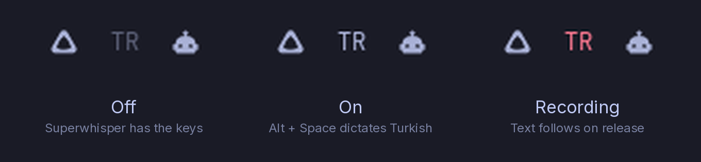

# soz



soz is offline Turkish dictation for [Omarchy](https://omarchy.org). Click
**TR** in the bar and Omarchy's dictation keys (Alt + Space, Right Alt) type
Turkish instead of going to your usual dictation app. Click it again and
that app has them back. Every session starts with soz off.

Speech is recognized on your own GPU by OpenAI's Whisper large-v3-turbo,
through [whisper.cpp](https://github.com/ggml-org/whisper.cpp) and Vulkan.
The model stays loaded while soz is on, so a five-second sentence is typed
about 150 ms after you let go of the key. Nothing you say leaves the machine.

*Söz* is Turkish for "word" or "speech".

## Contents

- [Why](#why)
- [Features](#features)
- [Requirements](#requirements)
- [Install](#install)
- [Using it](#using-it)
- [Command line](#command-line)
- [Speed](#speed)
- [How it works](#how-it-works)
- [Files](#files)
- [Troubleshooting](#troubleshooting)
- [Uninstall](#uninstall)
- [Development](#development)
- [Credits and license](#credits-and-license)

## Why

[Superwhisper](https://superwhisper.com) on Linux is fast, but its offline
models don't cover Turkish: Offline (Cohere Transcribe) supports 15
languages and Offline Lite (Parakeet v3) 25 European ones, and Turkish is in
neither. Its cloud mode does Turkish, but sends your audio away. soz fills
that one gap and leaves everything else to the app you already use: it
borrows the dictation keys only while TR is on.

## Features

- **One click in the bar** to switch between your dictation app and Turkish.
  Dimmed **TR** is off, lit is on, and the urgent color means recording.
- **The keys you already know.** soz plugs into Omarchy's own dictation
  switch, so Alt + Space (press to start, press to stop) and Right Alt (hold
  to talk) keep working the same way.
- **Off at every login,** even if it was on at shutdown.
- **Fast:** about 130–160 ms from releasing the key to text for a typical
  sentence on a Radeon RX 7900 XTX. See [Speed](#speed).
- **Accurate Turkish:** ç, ğ, ı, İ, ö, ş and ü, punctuation and
  capitalization come out as you'd write them.
- **Typed where you are,** into whichever window has focus, through the
  Wayland virtual keyboard. Your clipboard is never touched.
- **Gentle on resources while off:** turning soz off stops its service and
  frees the GPU memory (about 1.1 GB) it holds while on.
- **Your other app keeps its extra keys.** Superwhisper's own Ctrl + Alt +
  Space still dictates English while soz is on.
- **Fully offline** after a one-time model download (875 MB).

## Requirements

- **Omarchy** with switchable dictation backends (`omarchy-dictation`,
  `omarchy-default-dictation`). soz was built on Omarchy 4.5.
- **A Vulkan GPU** with about 1.1 GB of free video memory. Developed on an
  AMD Radeon RX 7900 XTX with Mesa's RADV driver. Other Vulkan GPUs should
  work; expect different speeds. Without a GPU, whisper.cpp falls back to the
  CPU, which is several times slower.
- **A microphone**: soz uses PipeWire's default input.
- **Packages:** `qt6-base`, `qt6-multimedia`, `vulkan-icd-loader`, `wtype`,
  `pipewire`, `curl`, `ffmpeg` and `jq` to run. To build: `cmake`,
  `vulkan-headers`, `spirv-headers`, `shaderc`, `gcc` and `make`. Omarchy
  already includes most of these.

soz works alongside any Omarchy dictation backend. It was built next to
Superwhisper, which is what it hands the keys back to when no other backend
was set.

## Install

### 1. Build tools

```sh
sudo pacman -S --needed cmake vulkan-headers spirv-headers shaderc
```

### 2. Build and install

```sh
git clone https://github.com/orhunakkan/soz.git
cd soz
bin/install          # builds whisper.cpp and soz, then installs the package (makepkg -fsi)
```

The first build downloads whisper.cpp 1.9.5 as a release tarball and compiles
it with the Vulkan backend, which takes about a minute.

### 3. Download the model

```sh
soz download         # Whisper large-v3-turbo, 8-bit (q8_0), 875 MB
```

It goes to `~/.local/share/soz/models/`.

### 4. Add the switch to the bar

```sh
soz bar on
```

This puts **TR** in the right side of the Omarchy bar, just after
Superwhisper's icon if it's there, otherwise just before the Bluetooth icon.
The shell picks it up immediately. `soz bar off` takes it out again.

## Using it

1. **Click TR** in the bar. It lights up; the model loads in about half a
   second, and a recording started in that moment still works.
2. **Click into any text field** and dictate:
   - **Alt + Space** starts recording; press it again to stop.
   - **Hold Right Alt**, speak, and release.

   A soft rising tone marks the start and a falling one the end. TR turns
   the urgent color while recording.
3. **The text is typed** where your cursor is.
4. **Click TR again** to hand the keys back.

| Key / action | soz off | soz on |
| --- | --- | --- |
| Click **TR** | Turn soz on | Turn soz off |
| Alt + Space | Your dictation app | Turkish: start / stop |
| Hold Right Alt | Your dictation app | Turkish: push to talk |
| Ctrl + Alt + Space | Superwhisper | Superwhisper (unchanged) |

Hover over TR to see what it's doing: off, on, loading the model, recording,
transcribing, or a problem.

The launcher (`Super + Space`) has a **Soz** entry that does the same as
clicking TR.

## Command line

```text
soz <command>
```

| Command | What it does |
| --- | --- |
| `soz on` | Make soz the dictation backend and start its service |
| `soz off` | Hand the keys back to the previous backend and stop the service |
| `soz switch` | On if off, off if on (what clicking TR runs) |
| `soz state` | One line: `on` or `off`, and what the service is doing |
| `soz status` | The service's status as JSON |
| `soz start` / `stop` / `toggle` | Record; what the dictation keys run |
| `soz cancel` | Drop the recording in progress without typing anything |
| `soz bar on` / `off` | Add TR to the Omarchy bar, or take it off |
| `soz transcribe FILE` | Transcribe any audio file ffmpeg reads and print timings |
| `soz download` | Download the model |
| `soz version` / `help` | Version and usage |

```console
$ soz state
on idle

$ soz status
{"load_ms":525.1,"model":"/home/you/.local/share/soz/models/ggml-large-v3-turbo-q8_0.bin","ok":true,"pending":0,"phase":"idle","ready":true}

$ soz transcribe toplanti.wav --repeat 3
model loaded and warmed in 448 ms
4.8 s of audio -> 153 ms: Yarın sabah saat 9'da toplantımız var. Lütfen raporu hazırlamayı unutma.
4.8 s of audio -> 143 ms: Yarın sabah saat 9'da toplantımız var. Lütfen raporu hazırlamayı unutma.
4.8 s of audio -> 145 ms: Yarın sabah saat 9'da toplantımız var. Lütfen raporu hazırlamayı unutma.
```

Commands exit 0 on success and 1 with the reason on stderr.

## Speed

Measured on an AMD Radeon RX 7900 XTX (RADV, Mesa) with an Intel Core
i7-14700K, from releasing the key to the text being ready:

| Audio | Time | Transcript |
| --- | --- | --- |
| 4.2 s | 145 ms | İstanbul'da hava bugün güneşli ama öğleden sonra yağmur yağabilir. |
| 4.8 s | 131 ms | Bu akşam eve dönerken markete uğrayıp süt, ekmek ve biraz peynir alacağım. |
| 4.8 s | 147 ms | Yarın sabah saat 9'da toplantımız var. Lütfen raporu hazırlamayı unutma. |
| 5.9 s | 157 ms | Geliştirdiğimiz uygulamanın performansı çok önemli bu yüzden her adımı ölçmemiz gerekiyor. |
| 11.0 s | 160 ms | (English test clip, `samples/jfk.wav`, with `SOZ_LANGUAGE=en`) |

Typing the text adds a few milliseconds. Turning soz on loads and warms the
model in about 0.5 s; it then holds about 1.1 GB of video memory and 115 MB
of RAM until it's turned off.

What made the difference:

| Change | Encoder pass |
| --- | --- |
| whisper.cpp defaults on Vulkan | 563 ms |
| Flash attention off (for comparison) | 1449 ms |
| Working buffers out of host-visible VRAM (`GGML_VK_DISABLE_HOST_VISIBLE_VIDMEM=1`) | 115 ms |

- **Host-visible video memory.** By default ggml's Vulkan backend puts its
  working buffers in the part of VRAM the CPU can map (ReBAR). On RADV that
  made even simple element-wise operations about ten times slower than they
  should be. soz sets `GGML_VK_DISABLE_HOST_VISIBLE_VIDMEM=1` before the
  backend starts, which took the encoder from 563 ms to 115 ms.
- **Flash attention** more than halves the encoder pass.
- **8-bit weights** (q8_0) are as fast as full precision on this card, and
  half the size, so soz uses them.
- **No per-dictation start-up.** The model is loaded once and warmed with a
  dummy pass, which builds the GPU pipelines before the first real dictation.
- **Less audio.** Silence before and after the speech is trimmed before
  Whisper sees it.
- **One retry candidate.** When Whisper isn't confident, it retries at a
  higher temperature; soz retries with one candidate instead of five, so a
  hard sentence can't cost a second.
- **A thin path from the key.** `soz start` and `soz stop` talk to the
  service over a Unix socket with plain system calls, before Qt is even
  initialized, so the shortcut returns in a few milliseconds.
- **Full 30-second context.** Shrinking Whisper's audio context to the clip
  length saved almost nothing once the memory fix was in, so soz keeps the
  full context, which is the most accurate.

## How it works

```text
 Alt + Space / Right Alt
        │
        ▼
 omarchy-dictation ──▶ omarchy-dictation-<backend> ──▶ superwhisper   (soz off)
                                                   └─▶ soz start|stop (soz on)
                                                          │ Unix socket
                                                          ▼
                                    ┌──────────── soz.service ────────────┐
                    microphone ────▶│ record (Qt Multimedia, 16 kHz mono)  │
                                    │ trim silence                         │
                                    │ Whisper large-v3-turbo on the GPU    │──▶ wtype ──▶ focused window
                                    │ clean up the text                    │
                                    └──────────────────────────────────────┘
                                         │ $XDG_RUNTIME_DIR/soz/{enabled,phase}
                                         ▼
                                    TR in the Omarchy bar
```

### Switching

Omarchy's dictation keys run `omarchy-dictation start|stop|toggle`, which
reads the selected backend from `~/.config/omarchy/defaults/dictation` and
runs `omarchy-dictation-<backend>`. The package installs
`omarchy-dictation-soz`, so `soz` can be that backend.

- **`soz on`** remembers the current backend in
  `~/.local/state/soz/previous-backend`, selects `soz` with Omarchy's
  `omarchy-dictation-use` (which first stops a recording the old backend may
  have running), and starts `soz.service`.
- **`soz off`** selects the remembered backend again and stops the service.
- **`soz-login.service`** runs `soz off` at the start of every graphical
  session. The package enables it for every user.

When Hyprland starts, Omarchy also loads `~/.config/<backend>/shortcuts.lua`
for the selected backend. That's where Superwhisper keeps its extra keys, so
soz writes its own `~/.config/soz/shortcuts.lua` to load the previous
backend's file. That way its extra keys survive a Hyprland restart while soz
is on.

### Dictating

`soz.service` runs `soz daemon`, which listens on
`$XDG_RUNTIME_DIR/soz/soz.sock` before loading the model, so a key pressed
while it loads still records.

1. **start** opens the default microphone at 16 kHz mono (or the device's
   own format, resampled), plays the start tone, and sets the phase to
   `recording`.
2. **stop** closes the microphone, plays the stop tone, and queues the audio
   for the engine thread. Recordings shorter than 0.3 s are dropped.
3. The **engine** trims leading and trailing silence (20 ms frames against a
   level relative to the loudest moment), drops recordings with no speech at
   all, and runs Whisper with the language fixed to Turkish, greedy decoding,
   no timestamps and no carried-over context.
4. The **text** is cleaned up: whitespace collapsed, and the captions Whisper
   invents over silence in Turkish ("Altyazı M.K.", "İzlediğiniz için
   teşekkürler") removed.
5. **wtype** types it into the focused window, reading it from standard
   input so nothing in the text can be taken as an option.
6. The result and its timings go to `$XDG_RUNTIME_DIR/soz/last.json`.

### The bar switch

`/usr/share/soz/bar/Soz.qml` is a QML bar module built from the shell's own
`BarWidget` and `WidgetButton`, so it looks like the icons around it. It
watches two small files in `$XDG_RUNTIME_DIR/soz/`: `enabled` (`1` or `0`)
and `phase` (`loading`, `idle`, `recording`, `transcribing` or `error`). A
click runs `soz switch` and lights the icon right away, without waiting for
the switch to finish.

## Files

| Path | What it is |
| --- | --- |
| `~/.local/share/soz/models/ggml-large-v3-turbo-q8_0.bin` | The model (`soz download`) |
| `~/.local/state/soz/previous-backend` | The backend soz hands the keys back to |
| `~/.config/soz/shortcuts.lua` | Loads the previous backend's extra shortcuts |
| `~/.config/omarchy/shell.json` | Holds the bar module, after `soz bar on` |
| `$XDG_RUNTIME_DIR/soz/soz.sock` | The service's socket |
| `$XDG_RUNTIME_DIR/soz/enabled`, `phase` | What the bar shows |
| `$XDG_RUNTIME_DIR/soz/last.json` | The last dictation and its timings |
| `$XDG_RUNTIME_DIR/soz/*.wav` | The start, stop and error tones |
| `/usr/bin/soz` | The app, with whisper.cpp built in |
| `/usr/bin/omarchy-dictation-soz` | The Omarchy dictation backend adapter |
| `/usr/lib/systemd/user/soz.service` | The dictation service |
| `/usr/lib/systemd/user/soz-login.service` | Turns soz off at login |
| `/usr/share/soz/bar/Soz.qml` | The bar switch |
| `/usr/share/applications/soz.desktop` | Launcher entry |

The last dictation looks like this (values from an example run):

```json
{"asr_ms":124.1,"audio_seconds":4.8,"created":1794589249,"delivered":true,
 "release_to_delivery_ms":129.6,"release_to_text_ms":125.6,"session":3,
 "text":"Yarın sabah saat 9'da toplantımız var. Lütfen raporu hazırlamayı unutma."}
```

## Troubleshooting

**TR doesn't appear in the bar**: run `soz bar on`. If it's in
`~/.config/omarchy/shell.json` but not drawn, run
`omarchy-shell shell rescanPlugins` or `omarchy restart shell`.

**TR is lit but the keys still go to the other app**: check
`omarchy-default-dictation` prints `soz`. If it doesn't, run `soz on` and
look at its error.

**Nothing is typed**: check `soz status` says `"ready":true`, then look at
the service log with `journalctl --user -u soz -n 50`. `wtype` must be
installed. Some XWayland apps don't accept the Wayland virtual keyboard.

**"The speech model is missing"**: run `soz download`.

**The first syllable gets cut off**: the microphone takes about 75 ms to open
after the key press. Start speaking just after the start tone.

**It's slow**: run `soz transcribe` on a recording and compare with
[Speed](#speed). `SOZ_VERBOSE=1 soz transcribe FILE` prints whisper.cpp's
own timing breakdown and which GPU it picked. If it says it's using the CPU,
check that `vulkaninfo --summary` lists your GPU.

**The wrong words, or English**: soz always decodes as Turkish. Mixed
sentences with English terms usually come out fine; whole English sentences
are better left to your other app (soz off).

## Uninstall

```sh
soz off
soz bar off
sudo pacman -R soz
rm -rf ~/.local/share/soz ~/.local/state/soz ~/.config/soz
```

## Development

```sh
bin/build    # whisper.cpp (static, Vulkan) and soz into build/
bin/test     # Qt Test, offscreen
bin/install  # makepkg -fsi from pkgbuild/
```

Run the service from the build tree without typing anywhere:

```sh
systemctl --user stop soz
SOZ_DRY_RUN=1 build/soz daemon &
build/soz start; sleep 3; build/soz stop
cat $XDG_RUNTIME_DIR/soz/last.json
```

| Variable | Effect |
| --- | --- |
| `SOZ_VERBOSE=1` | whisper.cpp and ggml logs, and per-run timings |
| `SOZ_DRY_RUN=1` | The service transcribes but doesn't type |
| `SOZ_MODEL=PATH` | Use another ggml Whisper model |
| `SOZ_MODEL_DIR=DIR` | Look for the model somewhere else |
| `SOZ_LANGUAGE=en` | Another language, for `soz transcribe` |
| `SOZ_CPU=1` | Run on the CPU, for `soz transcribe` |
| `SOZ_BAR_QML=PATH` | The bar module `soz bar on` points at |

The tests cover text cleanup, silence trimming, resampling, paths, atomic
writes, and the bar edits against temporary `shell.json` files. They never
touch your settings.

### Layout

```text
soz.pro                 qmake project; links whisper.cpp's static libraries
bin/                    build, test, install
src/main.cpp            commands; start/stop go straight to the socket
src/client.{h,cpp}      the socket client, plain POSIX
src/daemon.{h,cpp}      the service: socket, phases, recording, typing
src/engine.{h,cpp}      whisper.cpp: load, warm up, transcribe
src/recorder.{h,cpp}    the microphone, through Qt Multimedia
src/text.{h,cpp}        text cleanup, silence trimming, resampling
src/inserter.{h,cpp}    typing through wtype
src/switcher.{h,cpp}    on and off: the Omarchy backend and the service
src/bar.{h,cpp}         adding and removing the bar module with jq
src/cues.{h,cpp}        start and stop tones
src/paths.{h,cpp}       every file soz reads or writes
share/bar/Soz.qml       the bar switch
share/systemd/          soz.service, soz-login.service
share/omarchy/          omarchy-dictation-soz
tests/                  Qt Test suite
pkgbuild/               PKGBUILD, .desktop entry, icon
```

## Credits and license

MIT; see [LICENSE](LICENSE).

- [whisper.cpp](https://github.com/ggml-org/whisper.cpp) and ggml (MIT, the
  ggml authors) are built into the binary.
- [Whisper](https://github.com/openai/whisper) large-v3-turbo (MIT, OpenAI)
  is the model, downloaded from the whisper.cpp model repository on Hugging
  Face.
- The project layout follows Omarchy's apps (Omacut, Monologue) by David
  Heinemeier Hansson, under the MIT license.
